 

---

## 👩‍💻 About Me

- 🎓 B.Tech Computer Science Engineering student at **IKGPTU Main Campus**.
- 📊 Current CGPA: **8.9/10**.
- 🤖 Interested in **Machine Learning, Artificial Intelligence, and Software Development**.
- 💡 Enjoy building practical projects and exploring real-world applications of technology.
- 🌱 Currently strengthening my skills in **Machine Learning, GenAI, and Full-Stack Development**.
- 🎯 Open to software development, machine learning, and full-stack internship opportunities.

---

## 🛠️ Technical Skills

### Programming Languages

  

### Frontend Development

  

### Backend and Databases

  

### Machine Learning

- Scikit-learn
- Logistic Regression
- Random Forest
- Naive Bayes
- K-Nearest Neighbors (KNN)
- Support Vector Machines (SVM)
- Linear Regression
- Natural Language Processing (NLP)
- TF-IDF

### Tools

  

---

## 🚀 Featured Projects

### 1. AI Response Evaluator

An application designed to evaluate AI-generated responses using defined evaluation criteria and test cases.

- Python and Streamlit
- Gemini API integration
- Batch response evaluation
- Evaluation metrics and result tracking

[View Repository](https://github.com/Tavishi06/ai-response-evaluator)

### 2. Customer Churn Prediction

A machine learning project that predicts whether a customer is likely to leave a service.

- Python and Scikit-learn
- Logistic Regression and Random Forest
- Data preprocessing and model evaluation
- Streamlit interface

[View Repository](https://github.com/Tavishi06/Churn-Prediction)

### 3. Fake News Detection

An NLP-based machine learning project that classifies news content as real or fake.

- Text preprocessing
- Tokenization and stemming
- TF-IDF vectorization
- Machine learning classification

### 4. Web-Nova

A web development project focused on building a responsive and interactive web experience.

[Live Demo](https://webnova-murex.vercel.app/)

### 5. GoodFind

A web development project built to provide a user-friendly web experience.

[Live Demo](https://goodfind-nine.vercel.app/)

---

## GitHub Statistics

---

## 🐍 Contribution Activity

<picture>
  <source media="(prefers-color-scheme: dark)" srcset="https://raw.githubusercontent.com/Tavishi06/Tavishi06/output/github-contribution-grid-snake-dark.svg">
  <source media="(prefers-color-scheme: light)" srcset="https://raw.githubusercontent.com/Tavishi06/Tavishi06/output/github-contribution-grid-snake.svg">
  
</picture>

---

## 🤝 Connect With Me

  

**Thanks for visiting my profile!**

<i>Learning, building, and improving — one project at a time.</i>

