# TAVISHI KASHYAP

**Computer Science Engineering · Machine Learning · Software Development**

Building practical software and exploring intelligent applications.

[GitHub](https://github.com/Tavishi06) &nbsp; / &nbsp; [LinkedIn](https://www.linkedin.com/in/tavishi-kashyap-0409b6370/) &nbsp; / &nbsp; [Email](mailto:tavishikashyap02@gmail.com)

---

01 / INTRODUCTION

<h2>About Me</h2>

I'm a Computer Science Engineering student at **IKGPTU Main Campus**, graduating in 2027.

My interests lie in Machine Learning, Artificial Intelligence and Software Development. I enjoy developing practical applications, experimenting with machine learning models and exploring how intelligent systems can solve real-world problems.

- **Education:** B.Tech, Computer Science Engineering
- **Graduation:** 2027
- **CGPA:** 8.9/10
- **Current focus:** Machine Learning, Generative AI, RAG and Software Development
- **Career interests:** Software Development, Machine Learning and Full-Stack Engineering

---

02 / SELECTED WORK

<h2>Projects</h2>

### 01. CareerPilot AI

An in-development career preparation platform that compares a resume with a
target job description and turns skill gaps into an actionable learning and
interview plan.

- Extract selectable text from PDF resumes
- Compare supported skills and identify job-specific gaps
- Generate prerequisite-aware learning milestones with curated resources
- Practice job-skill interview questions with transparent rubric feedback

`React` `Tailwind CSS` `FastAPI` `Python` `Pydantic` `pypdf`

The current analysis and interview feedback use deterministic keyword and
rubric matching; Gemini and LangGraph integration remain planned work.

[View Source Code →](https://github.com/Tavishi06/CareerPilot)

### 02. AI Response Evaluator

An application designed to evaluate AI-generated responses against defined criteria and test cases.

- Automated response scoring and evaluation
- Batch evaluation of multiple test cases
- Evaluation results and failure tracking

`Python` `Streamlit` `Gemini API`

[View Source Code →](https://github.com/Tavishi06/ai-response-evaluator)

### 03. Customer Churn Prediction

A supervised machine learning application that predicts whether a customer is likely to discontinue a service.

- Data preprocessing and feature preparation
- Logistic Regression and Random Forest
- Model evaluation and prediction interface

`Python` `Scikit-learn` `Pandas` `Streamlit`

[View Source Code →](https://github.com/Tavishi06/Churn-Prediction)

### 04. Fake News Detection

An NLP-based classification project that identifies potentially fake news using text processing and machine learning.

- Text cleaning and preprocessing
- Tokenization and stop-word removal
- TF-IDF feature extraction
- Machine learning classification

`Python` `NLP` `TF-IDF` `Scikit-learn`

### 05. Web-Nova

A web development project focused on building an interactive and responsive web experience.

`React` `Node.js` `Express`

[View Live Application →](https://webnova-murex.vercel.app/)

### 06. GoodFind

A full-stack web application demonstrating practical application development and user-facing functionality.

`MERN Stack`

[View Live Application →](https://goodfind-nine.vercel.app/)

---

03 / TECHNOLOGY

<h2>Technical Stack</h2>

**Programming Languages**

`C` `C++` `Java` `Python`

**Machine Learning & AI**

`Scikit-learn` `Pandas` `NumPy` `NLP` `TF-IDF` `Generative AI` `RAG`

**Frontend Development**

`HTML` `CSS` `JavaScript` `React.js` `Next.js` `Tailwind CSS`

**Backend Development**

`Node.js` `Express.js` `FastAPI` `REST APIs`

**Databases & Authentication**

`MongoDB` `PostgreSQL` `Supabase` `JWT` `bcrypt`

**Development Tools**

`Git` `GitHub` `VS Code` `Postman`

---

04 / CURRENT FOCUS

<h2>What I'm Exploring</h2>

- Retrieval-Augmented Generation (RAG)
- Agentic AI and AI application development
- Building reliable AI-powered applications
- Problem-solving and software engineering fundamentals

---

05 / OPEN SOURCE ACTIVITY

<h2>GitHub Statistics</h2>

  

---

06 / CONTRIBUTION HISTORY

<h2>Consistency in Code</h2>

<picture>
  <source media="(prefers-color-scheme: dark)" srcset="https://raw.githubusercontent.com/Tavishi06/Tavishi06/output/github-contribution-grid-snake-dark.svg">
  <source media="(prefers-color-scheme: light)" srcset="https://raw.githubusercontent.com/Tavishi06/Tavishi06/output/github-contribution-grid-snake.svg">
  
</picture>

---

**TAVISHI KASHYAP**

Computer Science Engineering · 2027

[GitHub](https://github.com/Tavishi06) &nbsp; / &nbsp; [LinkedIn](https://www.linkedin.com/in/tavishi-kashyap-0409b6370/) &nbsp; / &nbsp; [Email](mailto:tavishikashyap02@gmail.com)

